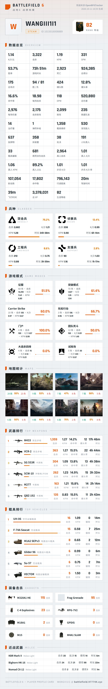
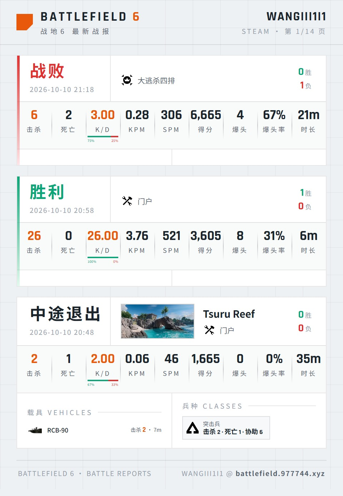

# astrbot_plugin_bf6tracker

> 战地风云 6（Battlefield 6）全平台战绩查询插件 · AstrBot Plugin

数据来自 [OpenBF6Tracker](https://battlefield.977744.xyz)，支持 **Origin / Steam / PSN / Xbox** 四大平台。支持**指令**与**智能体（LLM 工具）**双入口，使用 AstrBot 内置 `html_render`（HTML + Jinja2 文转图）输出战绩卡片，内置**暗色 / 浅色**两套主题。

## 预览

### 生涯战绩总览 `/bf6 <玩家名>`



### 最新战报 `/bf6战报 <玩家名>`



> 内置**暗色 / 浅色**两套主题，可在 AstrBot WebUI 的插件配置中切换（`theme`）。

## 功能

### 📊 战绩总览图 `/bf6 <玩家名>`

- **玩家信息**：平台徽章（EA / Steam / PSN / Xbox）、唯一 ID、**等级排名图标**
- **数据总览**：完整展示站点返回的全部生涯指标
  - 核心：K/D、击杀、KPM、SPM、胜率、游戏时长
  - 战斗：死亡、总得分、总场次、胜/负、爆头数、**爆头率**、命中率、每场击杀、DPM、总伤害、每场伤害
  - 支援：击杀助攻、助攻、救援队友、治疗量、弹药补给、载具维修、发现敌人、投掷物、拆装置、处决、小队救人
  - 真人 / 步兵：真人击杀、真人 K/D、真人 KPM、真人占比、步兵 K/D、步兵 K/D 率、最高连杀
  - 其它：载具摧毁、救死扶伤击杀、复仇击杀、射击数、命中数、行进距离、驾驶时间、飞行时间、总 XP、生涯等级
- **兵种**：4 兵种图标 + 时长占比条 + K/D / KPM / 时长
- **游戏模式**：图标 + 胜率条 + 场次 / 击杀 / K/D / KPM
- **地图**：实景缩略图 + 胜负场次与胜率
- **武器 / 载具排行**：物品图片 + 击杀 / KPM / 命中率 / 爆头率 / 时长
- **装备击杀**、**近战武器** 列表
- API 能提供的图片（排名、兵种、模式、地图、武器、载具、装备）全部展示；上游未提供图片时留空，不渲染占位块

### ⚔️ 最新战报图 `/bf6战报 <玩家名> [页码]`

- 每页默认 5 场对局（可在配置中调整 `page_size`）
- 每场展示：胜负色条 + **中文结果**（胜利 / 战败 / 平局 / 中途退出）、时间、**地图缩略图**、**模式图标**、胜负数
- 9 格对局数据：击杀 / 死亡 / K/D（含**击杀占比条**）/ KPM / SPM / 得分 / 爆头 / **爆头率** / 时长
- 本场明细：**武器**（图片 + 击杀 / KPM / 命中率 / 时长）、**载具**、**装备**、**兵种**、**近战**、参与模式与地图
- 「中途退出」判定与服务端一致：有击杀但无胜负记录、且模式分组也没有本局场次时判定为本局未计入正式统计
- 本局全程零数据的分组自动隐藏，不渲染无信息量的空条目

### 📄 战报翻页

| 指令 | 说明 |
|------|------|
| `/bf6战报 <玩家名> 2` | 直接跳到第 2 页 |
| `/bf6战报 <玩家名> 下一页` | 下一页 |
| `/bf6下一页` | 翻看上一次查询结果的后续页（按会话记忆） |
| `/bf6上一页` | 翻看上一次查询结果的前面页 |

### 🤖 智能体调用

对话中让大模型自动调用（需开启工具 / 函数调用）：

- `bf6_stats(player_name)` — 查询并发送战绩总览图
- `bf6_battle_reports(player_name, page)` — 查询并发送战报图

示例对话：

> 帮我查一下玩家 ilcy3344 的战地6战绩
>
> 看看 ilcy3344 最近两页的战报

## 指令一览

| 指令 | 参数 | 功能 |
|------|------|------|
| `/bf6` | `<玩家名>` | 生涯战绩总览图 |
| `/bf6战报` | `<玩家名>` `[页码]` | 最新对局战报图 |
| `/bf6下一页` | — | 战报下一页 |
| `/bf6上一页` | — | 战报上一页 |

## 配置项

在 AstrBot WebUI 的 **插件管理 → 战地6战绩查询 → 配置** 中调整：

| 配置 | 类型 | 默认值 | 说明 |
|------|------|--------|------|
| `theme` | string | `dark` | 出图主题：`dark` 暗色战术风 / `light` 浅色 |
| `api_base` | string | `https://battlefield.977744.xyz` | OpenBF6Tracker 站点地址（自建站可改，无需结尾斜杠） |
| `page_size` | int | `5` | 战报每页场数，建议 3–10 |
| `top_n` | int | `8` | 总览图武器 / 载具排行数量，3–15 |
| `timeout` | int | `30` | 站点 API 请求超时（秒） |
| `search_timeout` | int | `60` | 搜人超时（秒） |
| `render_timeout` | int | `150000` | 出图超时（毫秒） |

> ⚠️ **关于 `render_timeout`**
>
> AstrBot 的文转图（T2I）服务调用 Playwright `page.goto` 时默认只等 **30 秒**。本插件的总览图高度可达 6000+ px、包含约 40 张上游 CDN 图片，在配置较低的服务器上首次加载经常超过 30 秒，会导致 T2I 返回 `HTTP 500`，插件侧报错：
>
> ```
> 查询失败：All endpoints failed: HTTP 500
> ```
>
> 因此本插件默认把该超时放宽到 150 秒。如果你自建了 T2I 服务且希望更快失败，可以调小；如果仍然超时，可以继续调大。

## 安装

### 方式一：AstrBot 插件市场 / 仓库安装

AstrBot WebUI → **插件管理** → **安装插件** → 填入本仓库地址：

```
https://github.com/WONGIII/astrbot_plugin_bf6tracker
```

### 方式二：手动安装

1. 下载本仓库，把 `astrbot_plugin_bf6tracker` 整个目录放入 AstrBot 的 `data/plugins/` 下
2. 重启 AstrBot，或在 WebUI 插件页点击重载
3. 依赖 `aiohttp` 会依据 `requirements.txt` 自动安装

### 文转图（T2I）

插件使用 AstrBot 内置的 `html_render` 出图，需要 AstrBot 配置了可用的 T2I 服务：

- 默认使用官方远程渲染端点
- 也可自建 T2I 服务：`docker run -d -p 8999:8999 soulter/astrbot-t2i-service:latest`，然后在 AstrBot 配置中把 `t2i_endpoint` 指向它

## 工作原理

```
用户指令 / LLM 工具调用
        │
        ▼
  /api/search  解析玩家名 → identifier（服务端带本地已追踪玩家兜底）
        │
        ▼
  /api/profile 拉取生涯档案（TRN 格式，含 overview / kit / gamemode / level / weapon / vehicle / gadget / melee 等分段）
  /api/matches 拉取对局战报（逐局差分数据）
        │
        ▼
  build_overview() / build_matches()  转成模板数据
        │
        ▼
  Jinja2 模板 + html_render  →  T2I 服务  →  JPEG 图片
        │
        ▼
  发送到聊天平台
```

## 性能说明

插件对本体的开销做过针对性优化：

- **HTTP 会话复用**：全程共用一个带连接池的 `aiohttp.ClientSession`，避免每次请求重新做 TLS 握手；插件卸载时自动关闭
- **搜人一次请求**：玩家名解析走站点 `/api/search`（服务端已带本地兜底），不再直连上游逐个探测
- **模板缓存**：模板文件只在首次读取并常驻内存
- **战报分组过滤**：差分数据常带几十个「本局零数据」条目（装备段最多可达 19 个），过滤 + 限量后单张战报卡高度约减少 1/3
- 插件本身不处理图片渲染，出图耗时取决于 T2I 服务的性能

## 数据来源与致谢

- 数据与图片来自 [OpenBF6Tracker](https://battlefield.977744.xyz)
- 其数据源为 [GameTools Network](https://api.gametools.network) 公开 API
- 插件为本项目独立实现；模板视觉参考《战地》系列 UI 语言

## 兼容性

- AstrBot `>= 3.5.19`（`metadata.yaml` 中已声明）
- Python `>= 3.10`
- 已在 AstrBot `v3.5.24` / `v4.26.0-beta` 上验证

## License

[MIT](LICENSE)
